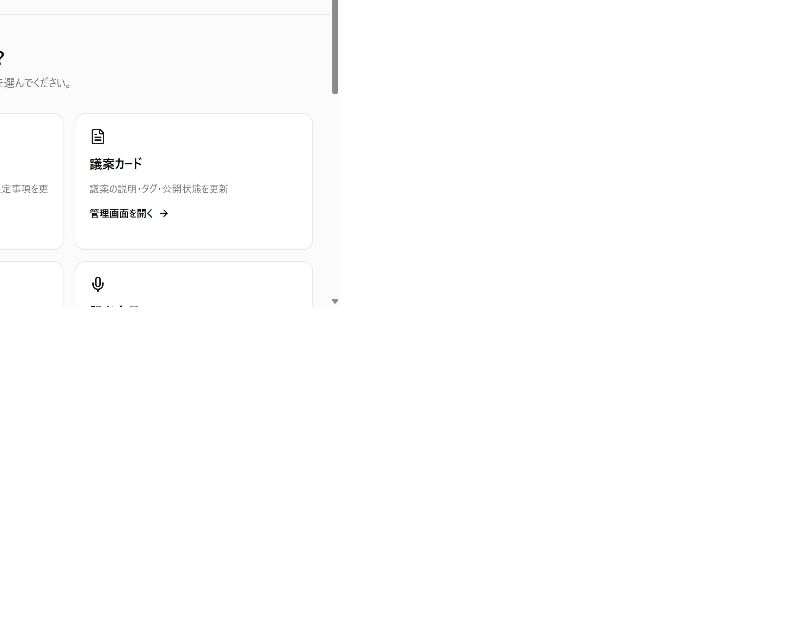
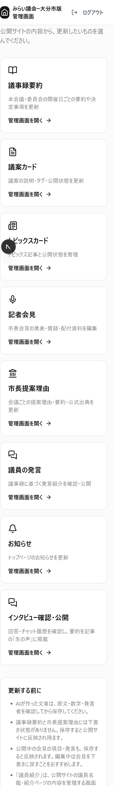

# 大分市版 管理画面再編設計・運用

2026-11-03 作成。大分市版「みらいぎかいっち」の実運用に合わせた管理画面。

## 目的・変更しないもの

- よく更新する順に「議事録要約・議案カード・トピックスカード・記者会見・市長提案理由・議員の発言・お知らせ」をまとめる。
- 既存の議案、トピックス、お知らせ、議員紹介、発言、議会マスタ、システム機能は維持する。URLも変更しない。
- DBスキーマ、環境変数、公開サイトの表示ロジックは変更しない。本番データ投入・AI生成・デプロイは今回のコード変更と別作業。
- Server Components / Server Actionsで `requireAdmin()` を実行し、Repository経由の `createAdminClient()` でアクセスする。

## 1. ナビゲーションとホーム

PCは固定サイドバー、スマートフォンは標準のdetails/summaryで開閉するメニュー。フォーカストラップが必要なモーダルは使わない。サイドバーは個別にスクロールでき、深い編集ページでも現在地を表示する。

| グループ | 表示名・URL |
|---|---|
| ホーム | ダッシュボード `/dashboard` |
| コンテンツ更新 | 議事録要約 `/minutes`、議案カード `/bills`、トピックスカード `/topics`、記者会見 `/press-conferences`、市長提案理由 `/mayor-proposals`、議員の発言 `/politician-speeches`、お知らせ `/information`、既存のAIインタビューの声 `/topic-voices` |
| 紹介ページ | 議員紹介 `/politicians`（既存の議員名鑑編集） |
| 議会の基本設定 | 定例会 `/council-sessions`、委員会 `/committees`、タグ `/tags`、会派 `/factions` |
| システム | AI情報収集 `/ai-collection`、管理者 `/admins` |

`/`、ログイン完了後、ログイン済みでの `/login` アクセスの3経路とも `/dashboard` に統一する。ダッシュボードには8機能への説明付きカードと、保存・公開の注意事項を表示する。最近の更新一覧は今回の範囲外。

### インタビューの確認・掲載

ダッシュボードとサイドバーの「インタビュー確認・公開」から既存の `/topic-voices` に移動する。「詳細・チャット履歴」で回答と要約を確認し、「この要約を生の声に採用」で記事へ掲載する。本人の公開同意などの既存の採用条件は変更しない。議案に紐づく回答一覧・インタビュー設定も従来どおり議案の管理画面から開ける。

### 画面例

管理者名・メールアドレスを含まないメイン領域のみ撮影。

## 2. 議事録要約：実際の公開ページとの対応

当初案の `committee_meetings` だけでは、現在の公開サイトの議事録要約を管理できないことが実装前調査で判明した。実運用の主データは `meetings` と `meeting_sessions` である。

| 管理画面 | 保存先・機能 |
|---|---|
| `/minutes` | `meetings` の本会議・委員会を日付降順で一覧。区分フィルタ、ページ送り、新規会議追加 |
| `/minutes/[id]` | 会議名・会期・日付・区分の編集、開催日一覧、開催日と議事録の追加 |
| `/minutes/[id]/sessions/[sessionId]` | `meeting_sessions` の見出し・日付・やさしい要約・詳細な要約・決定事項・原文を編集 |

出席・欠席議員は役職別の氏名欄と1行1人の入力欄で編集する。審議議案は番号・名称・説明・結果の行を追加・削除できる。JSONを直接書く必要はない。既存の当局情報や追加属性・議案リンク情報は保持する。不正な既存JSONは空の内容に置き換えず、編集を停止して通知する。公開画面が必要とする出席者の配列も検証する。

**下書き状態は存在しない。保存は公開サイトに反映され得る。** 保存前に原文・数字・発言者・会期・議案の対応を確認する。取り込み・AI生成を自動実行する画面ではなく、確認済み内容を人が編集・保存する画面である。

### 別形式の委員会アーカイブ

`/minutes` から `/committee-meetings` に移動できる。これは上記の議事録とは別データであり、委員会マスタ `/committees` とも異なる。

- 一覧：委員会名、スラッグ、開催日、公開状態、要約有無。スラッグ・公開状態フィルタ、ページ送り。
- 詳細 `/committee-meetings/[id]`：`committee_meetings.summary` と `publish_status` を編集。
- `committee_meeting_topics` のタイトル・要約・質疑の流れを議題ごとに保存。
- 関連議案ID・予算概要ID・出典発言範囲は参照のみ。原文と発言JSONも折りたたみで参照できる。
- 新規取り込み、AI生成、連携IDの変更は従来の運用で行う。
- 公開時は会議全体の要約を必須とする。議題は先に個別保存・確認してから公開する。

## 3. 記者会見

| 画面 | 機能 |
|---|---|
| `/press-conferences` | 日付降順一覧、状態フィルタ、項目数、ページ送り |
| `/press-conferences/new` | タイトル、URL識別名、開催日、動画URLを入力し下書き作成 |
| `/press-conferences/[id]/edit` | 基本情報・公開状態、発表・質疑、各項目の発言を編集 |

- 状態は既存DBの `draft / structuring / review / published / error`。通常の公開サイトは `published` のみ表示する。
- 発表・質疑：種類、見出し、要約、詳しい内容（既存の `detail`）、配付資料URL、表示順。追加・更新・削除。
- 発言：話者区分、市長・記者・担当課などの氏名、本文、表示順。追加・更新・削除。DB上の `governor` は画面では「市長」と表示する。
- 表示順は非負整数。数字の小さい順。同順位はID順で安定表示。フォームの±で数字を変え、保存して反映する。同順位があるときは各項目の数字を調整する。
- URL識別名は半角英小文字・数字・ハイフン。変更すると既存の公開URLが変わる旨を警告する。
- 動画は `watch?v=`、`youtu.be`、埋め込みURLに対応。`/live/` は動画IDを確認して `watch?v=` に直す。
- 新規会見はいったん下書き作成し、発表・質疑を追加後に公開する。項目のない会見の公開は拒否する。

### 保存単位・削除の注意

スキーマ変更なしで確実に保存するため、**会見全体を複数APIで一括保存しない**。基本情報・各項目・各発言をそれぞれ単一レコードとして保存する。保存ボタンに対象を明記し、結果を通知する。サーバー側でも会見→項目→発言の所属を確認する。

編集中は会見を下書きに戻し、各フォームを保存・確認した後に基本情報の状態を公開へ切り替える。公開中の会見では、項目・発言の保存や削除も公開サイトへ反映される。項目の削除は配下の発言も消すため、確認ダイアログで明示する。会見全体の削除は設けない。

## 4. 市長提案理由

- `/mayor-proposals`：本会議を日付降順で一覧、原文登録有無、ページ送り。
- `/mayor-proposals/[id]`：`meetings.mayor_proposal_text`・`mayor_proposal_summary`・`mayor_proposal_source_url` を編集。
- 原文が空でない会議だけが公開対象。市長紹介には要約と出典リンクを表示し、原文そのものは表示しない。
- 要約だけを入れて原文を空にする入力は拒否する。要約はMarkdownではなくプレーンテキストの改行を使う。
- 対象の会議がなければ `/minutes` から本会議を作成する。
- 下書き状態はない。保存前の確認ダイアログに公開反映を明示する。

## 検証・エラー

- すべての更新Actionで認証・入力検証。存在しない対象や所属が異なるIDを成功扱いにしない。
- リンクはhttp/httpsのみ。資格情報入りURL、危険なスキーム、不正なYouTubeホスト・動画IDを拒否する。
- 保存中は入力と再送信を無効化。失敗を画面と通知に表示し、フォームの入力内容を保持する。
- 一覧・詳細の読み取り失敗は「データなし」に偽装せず、エラー画面で再試行できる。
- 単体テスト：入力検証、ナビ現在地、ページ送りのフィルタ維持。
- UIテスト：議員の初回入力時の配列、当局・未知属性・既存議案リンクの保持、複数議案の入力分離。
- 品質ゲート：`pnpm lint`、`pnpm typecheck`、`pnpm test`。本番DBへのテスト書き込みは実行しない。

## 運用に関する制約

公開サイトと管理画面は別Next.jsアプリのため、管理画面の `revalidatePath` は公開サイトのキャッシュを直接破棄しない。表示反映のタイミングは既存の公開サイト設定に従う。既存のお知らせ・トピックス等の環境変数による有効化条件も変更しない。

AIが作成した本文の承認、本番DB書き込みの許可、一般公開の許可は従来どおり別々に確認する。この実装で本番データ自体は変更しない。
